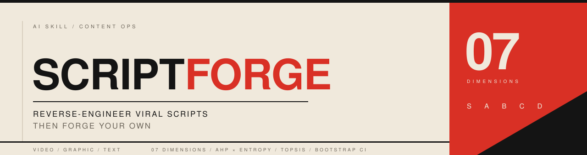

<p align="center">
  
</p>

<p align="center">
  
  
  
  
  
  
</p>

> **把一段爆款内容拆成可测量的结构，再锻造成你能直接填空、直接拍的模板。**
>
> 七层透视拆解 · 三形态矩阵 · 七维量化引擎 · 完形填空模板

<p align="center">
  <a href="#00-它是什么">它是什么</a> ·
  <a href="#01-快速开始">快速开始</a> ·
  <a href="#02-三形态">三形态</a> ·
  <a href="#03-七层透视拆解">七层拆解</a> ·
  <a href="#04-七维量化引擎">量化引擎</a> ·
  <a href="#05-模板与仿写">模板仿写</a> ·
  <a href="#08-项目结构">项目结构</a> ·
  <a href="#10-faq">FAQ</a> ·
  <a href="#11-边界">边界</a>
</p>

---

## 00 它是什么

**ScriptForge** 是一套运行在 AI 编码助手（Gemini CLI / Antigravity IDE / OpenClaw）上的 **Skill**：一个把「文案感觉」翻译成「结构 + 可复用模板 + 可复现分数」的执行包。

你丢进一段内容，它依次做完四件事：

| 序 | 动作 | 产出 | 承载 |
|:--:|------|------|------|
| 01 | 判定形态 | `video` / `graphic` / `text` + 置信度 + 判定依据 | `scripts/genre_probe.py` |
| 02 | 拆解结构 | 钩子 / 骨架 / 逻辑链 / 亮点 / 形态专属层 / 爆款位置 | `references/workflow-guide.md` |
| 03 | 量化位置 | 7 维得分 + 综合分 + 95% 置信区间 + 短板 | `scripts/viral_score.py` |
| 04 | 交出模板 | 完形填空骨架 + 跨品类仿写成稿 | `references/fill-blank-guide.md` |

**它明确不做的事**（这四条是项目红线，不是免责话术）：

- 不预测播放量。分数是**形态内相对位置**，不是流量预言。
- 不解析图片和视频画面。图文的「首图钩子」只吃你的文字描述。
- 不做机器学习。没有标注数据，就不装一个假的有监督模型。
- 不做跨形态、跨账号的绝对分比较。三形态权重档不同。

### 谁需要它

| 角色 | 真实处境 | 它给什么 |
|------|---------|---------|
| 短视频运营 | 一天 3–5 条文案，靠灵感续命 | 拆解 → 填空模板 → 批量出稿 |
| 内容编导 | 知道文案好，说不出好在哪 | 七层拆解把「感觉」变成可指的部件 |
| 运营主管 | 团队产出质量方差大 | 统一模板 + 可复现分数当验收线 |
| 电商商家 | 有货不会写带货稿 | 选模型 → 填产品信息 → 开拍 |
| 知识博主 | 想做文案方法论内容 | 直接产出拆解类口播稿 |

### 关键参数

| 形态 | 维度 | 权重来源 | 分区 | 第三方依赖 |
|:---:|:---:|:---:|:---:|:---:|
| 3 | 7 | 2（AHP × 熵权） | 5 级 S/A/B/C/D | 0 |

---

## 01 快速开始

零配置。有 Python 就能跑，纯标准库，不联网。

```bash
# 1 · 判定形态
python scripts/genre_probe.py --file samples/graphic.txt
#   形态: graphic    置信度: 高
#   依据: 命中标签 6 个 / @ 提及 0 个
#   量化: emoji 7 / 标签 6 / 小标题 0 / 论点句 0 / 证据比 0.0 / 金句密度 3.3333/千字

# 2 · 量化评分（默认输出 Markdown 报告）
python scripts/viral_score.py --file samples/graphic.txt
#   **37.43 / 100　分区 C**　95% CI [30.43, 49.77]（bca, B=400）

# 3 · 结构化输出（含 feature_trace，便于二次加工）
python scripts/viral_score.py --file samples/video.txt --json

# 4 · 自检验收
python -m unittest discover -s tests -v
```

### 六种用法

```text
① 拆解单条       帮我拆解这段文案：[粘贴内容]
② 拆解 + 指定品类  帮我拆解这段，并仿写一条手机壳红黑榜的：[粘贴内容]
③ 多条对比        帮我对比这两条，给出最佳仿拍对象：A=… B=…
④ 只要模板        帮我拆解这段，我只要完形填空模板：[粘贴内容]
⑤ 只要分数        帮我给这段文案打个分，告诉我短板在哪：[粘贴内容]
⑥ 主题生成        以「租房党收纳」为主题，写一条小红书图文：[可选参考文案]
```

> **触发词**：`文案拆解` `脚本拆解` `仿写` `完形填空` `爆款拆解` `脚本分析` `视频文案` `图文拆解` `笔记拆解` `小红书拆解` `长文拆解` `公众号拆解` `知乎拆解` `量化评分` `爆款评分` `爆款量化`
> 说出任意一个，智能体即自动激活本 Skill。

---

## 02 三形态

形态是**正交维度**，不是分支补丁。判定只看文本本身，按优先级短路：

| 形态 | 典型载体 | 判定强信号 | 专属量化项 |
|:----:|---------|-----------|-----------|
| `video` | 抖音 / 快手 / 视频号口播稿 | 出现 `口播` `镜头` `前3秒` `旁白` `字幕` 等元标记；或口语称呼 + 平均句长 ≤15 字 | 前 3 句字数、感叹号数、第二人称次数、平均句长 |
| `graphic` | 小红书笔记、公众号图文、头条图文 | 含 `#话题#` 或 `@用户`；首行 ≤20 字独立成行且正文 emoji 密集 | 标题字数与标题公式、emoji 数、标签数、段落数、单段行数中位数 |
| `text` | 知乎回答、公众号长文、微博长文 | 含 `一、` `二、` 或 `##` 小标题、`图1` `表1` `参考文献`；段落 >8 | 论点句数、证据/论点比、金句密度（每千字）、小标题数 |

**置信度**分高 / 中 / 低三档。走到兜底规则时判为低置信，输出会显式提示，允许你用 `--genre` 一键覆盖：

```bash
python scripts/viral_score.py --file 我的稿子.txt --genre graphic
```

> 判定规则与三套拆解矩阵集中在 `references/content-genres.md`。形态字段名是冻结契约，引擎按名读取，不许自造。

---

## 03 七层透视拆解

七层 = 五个通用分析引擎 + 一个形态专属层 + 一把量尺。前五层逐层往下切：

| 层 | 引擎 | 干什么 | 输出 |
|:--:|------|--------|------|
| 一 | 钩子雷达 | 识别 12 种钩子类型：痛点 / 利益 / 悬念 / 冲突 / 身份 / 场景 … | 钩子类型 + 原文标注 + 强度 S/A/B/C |
| 二 | 骨架扫描 | 透视叙事结构：AIDA / PAS / FAB / 故事弧 / 清单体 / 测评体 … | 段落功能标注 + 占比 + 节奏评价 |
| 三 | 逻辑还原 | 还原心理路径：认知 → 信任 → 欲望 → 行动 | 逻辑链流程图 + 每环效力 |
| 四 | 亮点挖掘 | 标出可复用元素：金句 / 情绪高潮 / 信息差 / 视觉化表达 | 原文标注 + 亮点类型 + 复用建议 |
| 五 | 爆款评估 | 给出爆款位置判断 | 优势 + 短板 + 一句话结论 |
| 六 | 形态专属层 | 按形态插入专属板块：`video` 钩子时间轴 / `graphic` 标题公式与标签 / `text` 论点链（规则见 §02） | 形态专属量化读数 |
| 七 | 量化评分 | **交给引擎算**（见 §04），不再是拍脑袋打分 | 7 维分 + 综合分 + 95% CI + 短板 |

改造前的第五层是「六维各打 1–10 分，等权相加」——没有计算规则、没有权重来源、没有基线、没有不确定度，换个人打就变。现在第五层给判断，第七层给数，任何一个数字都能回溯到原文计数。

---

## 04 七维量化引擎

核心立场：**爆款不是玄学，是一组可测量的分布特征**。但「可测量」不等于「可预测」。

### 流水线

```text
原始文本
  │
  ├─ ① 特征层  features.py      可数的量：分句 / 字数 / 句长序列 / 计数 / 词频
  ├─ ② 指标层  info · rhythm · affect · align    熵 · JS · Zipf · Gini · DFT · OLS · CUSUM · 马尔可夫
  ├─ ③ 维度层  engine.dimensions()      7 维，全部归一化到 [0,1]，全部效益型
  ├─ ④ 权重层  mcdm.py          AHP（主观先验，CR 硬校验）+ 熵权（客观区分度）→ 组合赋权
  └─ ⑤ 综合层  mcdm.topsis()    TOPSIS 贴近度 → score100；句级 Bootstrap(BCa) → 95% CI
```

**可回溯铁律**：每一维的分数都能在 `feature_trace` 里找到原始计数。找不到来源的数字不许出现在报告里。

### 七个维度

| 维度 | 算法内核 | 一个必须防住的陷阱 |
|------|---------|------------------|
| 钩子力 `hook` | Surprisal（−log₂p）+ 钩子词加权 + 前 3 句标点强度 | `p=0` 时 surprisal 发散 → 先 Lidstone 平滑再取对数 |
| 信息密度 `density` | 每百字信息单元 + 归一化词汇熵 + Zipf α | Zipf 只在中间段线性 → R²<0.70 **直接剔除该项权重**，不许硬用 |
| 节奏冲击 `rhythm` | Gini + CV + MAD 稳健 CV + DFT 主周期 | 脉冲串频谱是等幅谐波 → 取「最低频的局部极大值」，不取全局最大峰 |
| 情绪驱动 `emotion` | 情绪序列波动率 + OLS 斜率 + CUSUM 变点 | 伪回归风险 → 斜率强制回带 `se / t / r²`，只作趋势描述 |
| 说服转化 `persuasion` | 信任锚密度 + 数字密度 + CTA 位置衰减 | 绝对化用语是负资产 → **扣分**而非加分 |
| 差异化 `distinction` | JS 散度 − 词表规模噪声地板 | 不扣地板，所有输入都会饱和到 1.0，该维度变成假指标 |
| 可复制性 `replicability` | 一阶马尔可夫熵率 | 转移概率必须按行归一化；样本 <10 时折减并标低置信 |

### 权重、综合、区间

- **主观权重 · AHP**：每形态一份 7×7 判断矩阵（Saaty 1–9）。主特征向量用幂迭代求，`CR > 0.1` 直接抛 `InconsistentMatrixError` —— 不许静默放行。实测 `CR = 0.0149`。
- **客观权重 · 熵权法**：`w_j ∝ 1−e_j`。所有指标等值时熵为 1、权重为 0，分母除零 → 回退均权。
- **组合**：`w = 0.55·w_AHP + 0.45·w_熵权`，再归一化。
- **综合 · TOPSIS 贴近度**：方案集 = 本文 + 5 个参照原型（顶配/优秀/中等/偏弱/差）。`score100 = 100·C*`，分区 **S≥80 / A≥65 / B≥50 / C≥35 / D<35**。
- **不确定度 · 句级 Bootstrap BCa**：重采样 400 次重算全链，给 95% CI。**禁止裸标量**：报分必须带区间。
- **复现性**：所有随机过程接受 `--seed`（默认 `20260101`）。同输入同 seed，输出逐字节一致，有回归测试守着。

### 真实输出长什么样

```markdown
# 爆款量化评估 · 视频口播（形态判定置信度：中）

- 判定依据：口语称呼 2 处 + 平均句长 14.7 字
- 规模：206 字 / 14 句 / 7 段

## 一、综合分
**41.78 / 100　分区 C**　95% CI [33.78, 51.21]（bca, B=400）

## 二、七维得分

| 维度 | 分数 | 区间 | 说明 |
|---|---|---|---|
| 钩子力 `hook` | 0.462 | [0.2021, 0.774] | — |
| 信息密度 `density` | 0.665 | [0.4963, 0.7904] | — |
| 节奏冲击 `rhythm` | 0.439 | [0.2963, 0.5287] | — |
| 情绪驱动 `emotion` | 0.343 | [0.0, 0.5216] | — |
| 说服转化 `persuasion` | 0.390 | [0.0716, 0.5397] | — |
| 差异化 `distinction` | 0.864 | [0.8148, 0.9974] | — |
| 可复制性 `replicability` | 0.544 | [0.2801, 0.7028] | — |

## 三、优势 / 短板
优势：差异化（0.864）、信息密度（0.665）
短板：情绪驱动（0.343）、说服转化（0.390）
该形态最该补的维度：hook / rhythm

## 四、权重来源（可审计）
- AHP 一致性比率 CR = 0.014951（< 0.1 才可用）
- 组合赋权 alpha（主观占比）= 0.55
```

报告还强制带上 `reliability_notes`（哪些指标这轮不可信）、`feature_trace`（每维的原始计数）、`disclaimer`（免责边界）。

### 解读纪律

写报告时必须守住这五条：

1. 报分必须带区间：`41.8（95% CI 33.7–50.1，BCa，B=400）`，不许只写 `41.8`。
2. 报分必须带形态：video 的 60 分 ≠ graphic 的 60 分。
3. 短板必须给可执行改法。不是「情绪驱动低」，而是「第 3–5 句情绪词为零，建议插入一个具体痛点场景」。
4. 出现 `reliability_notes` 必须转述给用户，不许吞掉。
5. 禁止输出「本分预测播放量约 X」。

### CLI

| 参数 | 说明 |
|------|------|
| `--file PATH` | 读取 UTF-8 内容文件 |
| `--text TEXT` | 直接传入内容 |
| `--genre {auto,video,graphic,text}` | 指定形态，默认 `auto` 自动判定 |
| `--json` | 输出结构化 JSON（含 `feature_trace`） |
| `--seed N` | Bootstrap 随机种子，默认 `20260101` |
| `--boot N` | Bootstrap 次数，默认 `400`；`0` 关闭置信区间（约 0.01s） |

### 校准状态：`CALIBRATION_PENDING`

必须说清楚：**所有词表、饱和上限、参照原型、分区阈值都是人工先验**，没有一条来自真实数据。

校准前的三条禁令：

- 禁止拿本引擎分数对外宣称「这条会爆」。
- 禁止跨账号比较（粉丝基数、流量池不同）。
- 禁止跨形态比较绝对值（三形态权重档不同）。

校准步骤（集语料 → 换参照 → 重估 caps → 重估 AHP 先验 → 重估分区阈值 → 验证分离度）写在 `references/math-engine.md` §7，公式与陷阱在 §2–§6。

---

## 05 模板与仿写

### 脚本模型

从拆解结果提炼**可复用框架**，每个模型 4 字命名：

| 形态 | 模型 | 核心逻辑 | 适用品类 |
|:---:|------|---------|---------|
| video | **吐槽安利** | 冲突钩子 → 后悔对比 → 场景延展 → 价格暴击 | 全品类通用 |
| video | **痛点暴击** | 先痛后解 + 数据说话 + 场景化验证 | 功能性产品（护肤 / 家电 / 3C） |
| video | **清单收割** | 精准圈人 + 数量冲击 + 节奏感 | 多 SKU / 套装推荐 |
| graphic | **圈人清单** | 标题当筛选器 + 分段呼吸感 + 标签三型组合（品类拿曝光 / 人群拿精准 / 长尾拿搜索） | 多 SKU、场景套装、租房 / 通勤 / 学生党集合 |
| graphic | **亲测打脸** | 先自曝怀疑 → 缺点必须真 → 复购当证据 | 美妆、个护、小家电、3C（需有可感知效果） |
| text | **结论前置** | 结论放最前 → 限定语建可信 → 段尾留可引用句 | 方法论、行业观察、认知类话题 |
| text | **反常识立论** | 先扬后破 → 机制解释当护城河 → 留争论空间 | 争议话题、行业误区、认知纠偏 |

7 个模型：3 个口播、2 个图文、2 个长文。每次拆出新模型，自动沉淀进 `references/script-models.md`。

### 完形填空模板（核心交付物）

运营同学不写文案，只填空。保留逻辑骨架与金句，产品信息做成占位符：

```text
你是我花钱请来看这条视频的，但我先说清楚：
[______①投放平台]只能选择[______②泛人群标签]这类泛人群，
不能精确选到"[______③精准人群]"。所以如果你对[______④核心需求]不感兴趣，
或者从没踩过[______⑤品类]的雷，那我跟你说声抱歉，你可以划走了。
剩下的各位，就是我斥巨资请来的座上宾。

本期风大[______⑤品类]红黑榜，依旧是老规矩：不好用的排雷，好用的招商。

先说不建议买的。第一款是[______⑥品牌]的[______⑦产品]...

[______⑧推荐品牌]的[______⑨推荐产品]，[______⑩肤质]用特别合适。
[______⑪质地描述]，上脸[______⑫妆效描述]，
持妆[______⑬小时数]小时，[______⑭持妆表现]。
```

每个占位符附填写说明与多品类示例。三种形态的占位类型不同——模板不是同一份改名词：

| 形态 | 模板必须包含的占位 | 骨架示例 |
|:---:|------------------|---------|
| `video` | 钩子句 / 转折 / 场景 / 数据 / CTA | 上面这份粉底液红黑榜 |
| `graphic` | 标题公式位 / 首图钩子位 / 分段落位 / 标签位 | `[人群/场景]｜[数量]个让我[爽点]的[品类]` |
| `text` | 论点位 / 证据位 / 限定语位 / 小标题位 | `很多人把[问题]理解为[表面归因]，但本质是[真实归因]` |

规则与粒度控制见 `references/fill-blank-guide.md`。

### 跨品类仿写

同一个「吐槽安利」模型，换品类不换骨架：

| 原始品类 | 仿写品类 | 结果 |
|---------|---------|------|
| 粉底液测评 | 即食鸡胸肉测评 | 验证通过 |
| 粉底液测评 | 手机壳红黑榜 | 验证通过 |
| 粉底液测评 | 蓝牙耳机排雷 | 自动推荐 |

### 知识分享稿（可选）

以运营博主视角，把拆解结论转成可直接拍摄的**方法论口播稿**——适合做文案教学类内容。

---

## 06 工作流

```text
Phase 0      Phase 1      Phase 2      Phase 3      Phase 4      Phase 5      Phase 6
形态判定  ─▶  接收感知  ─▶  七层拆解  ─▶  模型提炼  ─▶  完形填空  ─▶  仿写脚本  ─▶  知识分享
   │            │            │            │            │            │            │
   ▼            ▼            ▼            ▼            ▼            ▼            ▼
video/     品类/人群     7 层执行      4 字命名     [______]     指定或自动    博主视角
graphic/   类型/调性     逐层执行      匹配或新建    占位+指南    推荐品类      口播稿
text       时长/一句话                                            完整文案
```

> Phase 0 是新增环节：先定形态，再选拆解矩阵。形态判错，后面全错。

---

## 07 输出结构

每次拆解按固定顺序输出（回归保护：板块名称与顺序不随版本变化）：

```text
零、形态声明      video / graphic / text ｜ 置信度 高/中/低 ｜ 判定依据
一、基础判断      品类 / 人群 / 类型 / 时长 / 调性 / 一句话总结
二、钩子拆解      钩子类型扫描 + 原文标注 + 强度评分
三、结构解码      框架名称 + 段落功能表 + 占比 + 节奏评价
四、说服逻辑链    心理路径还原 + 信任锚 + CTA 效力
五、亮点标注      金句 / 情绪高潮 / 信息差 / 视觉化表达
六、爆款潜力评估  七维分数 + 综合分 + 95% CI + 短板 Top2
七、完形填空模板  核心交付物，填空即用
八、仿写脚本      指定或推荐品类的完整文案
九、知识分享文案  （可选）运营博主口播稿
```

**形态专属板块**插入在「三、结构解码」之后、「六、爆款潜力评估」之前：

| 形态 | 追加板块 |
|------|---------|
| `video` | 钩子时间轴 · 口播节奏 |
| `graphic` | 标题公式 · 首图钩子 · 分段节奏 · 标签策略 |
| `text` | 论点链 · 论证结构 · 金句密度 · 长文钩子 |

> 别把「层」和「板块」混了：层是分析引擎（七个），板块是报告章节（零 + 九）。两套编号不同源。

多条内容一起提交时自动进入**对比模式**：逐条拆解 → 横向对比表 → 推荐最佳仿拍对象并说明理由。

---

## 08 项目结构

```text
ScriptForge/
├── SKILL.md                         # 技能主入口（AI 读取）
├── skill.manifest.json              # 元数据与执行配置
│
├── references/                      # 规则与知识库
│   ├── math-engine.md               #   量化引擎数学规范（公式 / 陷阱 / 解读）
│   ├── content-genres.md            #   三形态判定与专属拆解矩阵
│   ├── workflow-guide.md            #   七阶段工作流执行指南
│   ├── script-models.md             #   脚本模型库
│   ├── fill-blank-guide.md          #   完形填空生成规则
│   ├── platform-insights.md         #   平台算法与内容趋势
│   ├── mcp-reference.md             #   可选 MCP 数据通道
│   └── brief-schema.md              #   内容简报字段契约
│
├── assets/
│   ├── banner.svg                   #   视觉横幅（矢量）
│   ├── mark.svg                     #   品牌标记（播放三角即笔尖）
│   ├── report-template.md           #   拆解报告模板
│   ├── report-template-graphic.md   #   图文拆解报告模板
│   ├── report-template-text.md      #   长文拆解报告模板
│   ├── quant-scorecard-template.md  #   量化评分卡模板
│   ├── calendar-template.md         #   完形填空输出示范
│   └── content-brief-template.md    #   仿写脚本输出模板
│
├── scripts/
│   ├── genre_probe.py               #   形态判定 CLI
│   ├── viral_score.py               #   量化评分 CLI
│   ├── viralmath/                   #   引擎内核（11 个 .py：10 个模块 + __init__）
│   │   ├── __init__.py              #     包入口与模块导航
│   │   ├── features.py              #     特征抽取
│   │   ├── info.py                  #     熵 / Surprisal / JS / Zipf
│   │   ├── rhythm.py                #     Gini / CV / ACF / DFT / 马尔可夫熵率
│   │   ├── affect.py                #     情绪序列 / OLS / CUSUM
│   │   ├── mcdm.py                  #     AHP / 熵权 / 组合赋权 / TOPSIS
│   │   ├── uncertainty.py           #     Bootstrap BCa / Beta 后验
│   │   ├── align.py                 #     余弦 / DTW
│   │   ├── genres.py                #     三形态权重档 + 分区阈值
│   │   ├── calibration.py           #     词表与阈值常量（CALIBRATION_PENDING）
│   │   └── engine.py                #     编排：特征 → 指标 → 维度 → 权重 → 综合
│   ├── generate-content-brief.py    #   [已废弃]
│   └── unpack-7z.py                 #   [已废弃]
│
├── samples/                         # 三形态验收样本（video / graphic / text）
├── tests/test_viralmath.py          # 单元测试（标准库 unittest）
└── tasks/                           # 变更四件套（CHANGE / SPEC / TRACEABILITY / 编排）
    ├── CHG-20261115-multimodal-decompose/
    └── CHG-20261115-viralmath-engine/
```

---

## 09 安装与部署

### 前置条件

- [Gemini CLI](https://github.com/google-gemini/gemini-cli) / [Antigravity IDE](https://antigravity.dev) / OpenClaw 任一
- Python ≥ 3.9（仅量化引擎与形态判定需要；纯拆解流程不依赖 Python）
- 无需联网，无需 API Key，无需第三方包

### 方式一：Git Clone

```bash
git clone https://github.com/hhx465453939/ScriptForge.git \
  ~/.gemini/config/skills/scriptforge

# 验证
gemini --list-skills | grep scriptforge
```

### 方式二：交给智能体自己装

把仓库地址直接发给你的 OpenClaw / Hermas 智能体：

```text
请帮我部署这个 skill：https://github.com/hhx465453939/ScriptForge
```

### 可选：配置 MCP 数据源

仅在需要搜竞品文案做参考时才需要：

```json
{
  "socialdatax-xhs": "小红书笔记搜索",
  "socialdatax-douyin": "抖音视频搜索"
}
```

> 核心拆解与量化功能**不依赖任何外部 MCP**。

---

## 10 FAQ

<details>
<summary><strong>需要联网吗？</strong></summary>

不需要。拆解、模型提炼、完形填空、仿写、量化评分全部本地完成。只有主动搜竞品时才用到可选 MCP。
</details>

<details>
<summary><strong>分数和播放量有关系吗？</strong></summary>

没有可靠的因果关系，我们也禁止这么宣称。分数是**对参照原型的 TOPSIS 贴近度**，含义是「这条内容在同形态里的相对位置」。它回答「结构上还差什么」，不回答「能有多少播放」。
</details>

<details>
<summary><strong>为什么我的文案分数不高？</strong></summary>

先看两处：`weaknesses`（哪两维最弱）和 `priority_dimensions_for_genre`（你这个形态最吃哪两维）。短文案还会命中 `reliability_notes`——句数 <20 时主周期检测不可信，那项取中性值，分数会被压低但不代表文案差。
</details>

<details>
<summary><strong>为什么标 `CALIBRATION_PENDING`？</strong></summary>

因为当前所有阈值和参照语料都是人工先验，还没用真实爆款数据回灌。用法上：可以拿它做**同账号内、同形态的横向比较**和改稿指引，不能拿它做对外背书。校准协议见 `references/math-engine.md` §7。
</details>

<details>
<summary><strong>完形填空模板真能直接用吗？</strong></summary>

能。模板保留逻辑骨架、转折词、情绪表达、CTA 句式这些「生效要素」，只把产品特定信息做成占位符。平均 5–8 分钟填完。
</details>

<details>
<summary><strong>跟直接让 AI 写文案有什么区别？</strong></summary>

直接生成是从 0 开始，质量不可控。ScriptForge 先从**真实跑量文案**里提炼逻辑，再基于这套逻辑生成——等于站在别人跑量数据的肩膀上，并且每一步结论都能回溯到原文和计数。
</details>

---

## 11 边界

诚实清单。这些是已知盲区，不是待办：

| 盲区 | 影响 | 为什么不修 |
|------|------|-----------|
| 不解析图片 / 视频画面 | 图文「首图钩子」只能吃文字描述 | 无 OCR / 抽帧依赖，保持零依赖可移植 |
| 中文分词用字符二元组近似 | 做不了句法级特征 | 避免引入 jieba；分布型指标不受影响 |
| 情绪词典对反讽 / 留白无感 | 高级幽默文案会被低估 | 无标注数据训练情绪模型 |
| JS 散度对文本长度敏感 | 差异化维度偏袒长文 | 已用噪声地板校正缓解；彻底解法是加大基线语料 |
| 可复制性只看结构状态转移 | 抓不到语气 / 人设的可复制性 | 人格化特征无法用马尔可夫表达 |
| 不预测播放量 | 不能当投放决策依据 | 无因果识别，只有形态内相对位置 |

---

## 12 贡献

| 方向 | 怎么做 |
|------|--------|
| 扩充模型库 | 拆出新模型 → 按 `references/script-models.md` 里的模板格式提 PR |
| 校准引擎 | 有真实爆款数据（带完播/互动/转化指标）→ 按 `math-engine.md` §7 提交校准报告 |
| 补充平台洞察 | `references/platform-insights.md` 需要持续更新算法变化 |
| 报问题 | 提 Issue 时附上原文案 + 期望输出 + 实际输出（含 `feature_trace`） |

改公式必须同时改两处：`scripts/viralmath/` 的代码与 `references/math-engine.md` 的推理链。只改一处算破坏契约。

---

## License

本项目采用 [MIT License](LICENSE) 开源。

---

<p align="right">
  <sub>SCRIPTFORGE · 07 DIMENSIONS · AHP × ENTROPY · TOPSIS · BOOTSTRAP CI · CALIBRATION PENDING</sub>
</p>
